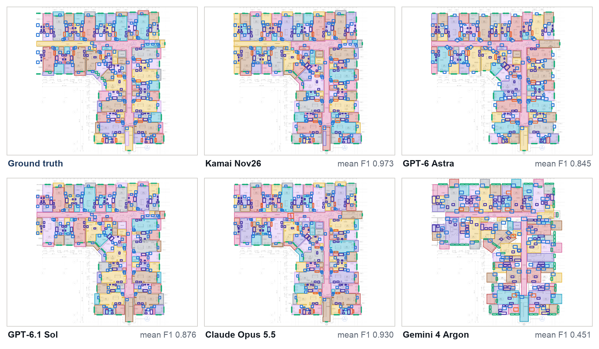
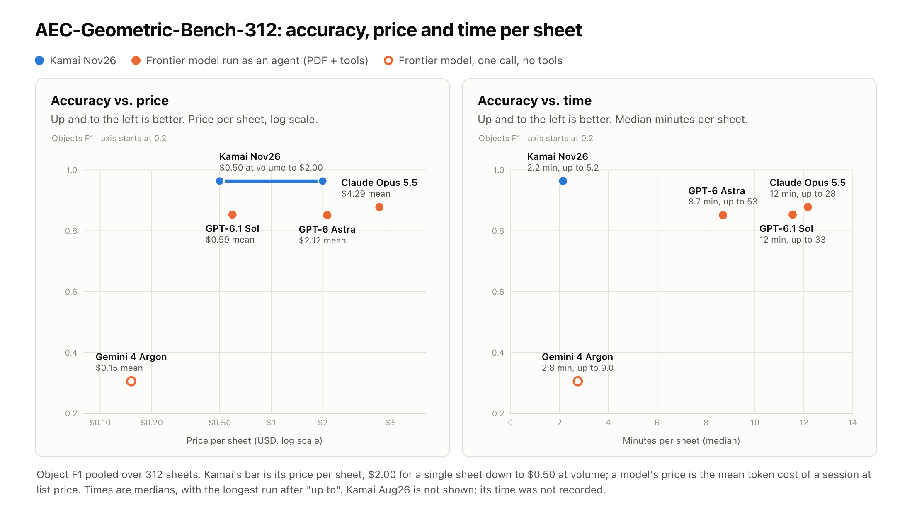

# AEC-Geometric-Bench

Geometric and symbolic data extraction from construction drawings: a benchmark for
reading what is on an architectural sheet, the doors, windows and fixtures a quantity
takeoff prices, and the walls and enclosed areas it measures.

The corpus split is **AEC-Geometric-Bench-312** (everything scored) and
**AEC-Geometric-Bench-15** (the sheets released here).



Ground truth first, then Kamai Nov26 and the four models on the identical crop of one
released sheet. The paper shows all six systems on seven more sheets.

A PDF goes in and a takeoff comes out. Six systems are scored on that task:

* **Kamai**, a production pipeline built for construction drawings, in its August and
  November 2026 versions, accessed as its hosted API.
* **GPT-6 Astra, GPT-6.1 Sol and Claude Opus 5.5 run as agents.** Each is handed the PDF and
  a code environment, may render, zoom, crop, parse and run code on the file, and works for
  as long as it chooses.
* **Gemini 4 Argon in a single call**, the PDF and the same instructions, without tools.

The corpus is 312 single-page architectural sheets issued for construction, carrying
25,432 annotated object instances, 59,328 wall shapes and
16,112 area shapes. **Fifteen of those sheets are released here with their
ground truth, every system's output on them and the instructions the models received**, so
the result can be recomputed rather than taken on trust.

> **November 2026 revision.** This replaces the August 2026 release. Every model now
> receives the PDF file itself and may use tools; the August release gave each model one
> look at the rendered page. The models are their vendors' current ones, a second version of
> the Kamai pipeline (Nov26) is added, elevators and stairs are scored as objects, and an
> object is matched by whether it was found, not by whether its box has the annotated size.
> The new rule is more lenient to every system: under the August rules Kamai Aug26 scored
> 0.930; the same output scores 0.948 here. Time and price per sheet are now reported, and
> the paper adds a second benchmark, door and window tags.

## Results on AEC-Geometric-Bench-312



Object F1 against price per sheet (left, log scale) and against median minutes per sheet
(right), on all 312 sheets. Kamai's price is a bar because it falls with volume. Kamai
Aug26 is not drawn: its time was not recorded.

| system | P | R | **F1** | wall px | area px | area inst | minutes per sheet, median | price per sheet |
|---|---|---|---|---|---|---|---|---|
| Kamai Nov26 | 0.964 | 0.962 | **0.963** | 0.939 | 0.969 | 0.921 | 2.2 | $0.50–$2.00 |
| Kamai Aug26 | 0.947 | 0.949 | **0.948** | 0.934 | 0.982 | 0.915 | — | — |
| GPT-6 Astra | 0.887 | 0.818 | **0.851** | 0.792 | 0.936 | 0.784 | 8.7 | $2.12 |
| GPT-6.1 Sol | 0.889 | 0.820 | **0.853** | 0.804 | 0.936 | 0.779 | 12 | $0.59 |
| Claude Opus 5.5 | 0.924 | 0.836 | **0.878** | 0.847 | 0.935 | 0.763 | 12 | $4.29 |
| Gemini 4 Argon | 0.328 | 0.285 | **0.305** | 0.477 | 0.862 | 0.432 | 2.8 | $0.15 |

Object F1 is over ten classes, pooled across sheets. Kamai Aug26 has no elevator or
stairs class, so its object columns are over the other eight.

* **Objects.** Kamai Nov26 reaches 0.963. The three agents reach 0.851 to 0.878, the
  strongest being Claude Opus 5.5, and the single call 0.305. Counting misses and false
  reports together, the agents make 3.2 to 3.9 times as many object errors as Kamai Nov26.
* **Walls and areas.** Kamai Nov26 is ahead of every model on all three measures. Area is
  where the agents come closest: 0.935 to 0.936 area pixel F1 against 0.969. By instance
  they reach 0.763 to 0.784 against 0.921: recovering the floor area is easier than
  partitioning it into the right rooms.
* **What the tools are worth.** In one call without tools Gemini 4 Argon finds 29% of the
  objects. The agents find 82% to 84%.
* **Time.** Kamai returned a sheet in a median of 2.2 minutes; an agent session ran for a
  median of 8.7 (GPT-6 Astra), 12 (GPT-6.1 Sol) and 12 (Claude Opus 5.5) minutes.
* **Price.** Kamai is priced per sheet, from $2.00 for a single sheet down to $0.50 at volume.
  An agent session cost a mean of $2.12 (GPT-6 Astra), $0.59 (GPT-6.1 Sol) and $4.29 (Claude Opus 5.5)
  in tokens at list price.
  Kamai costs less at any volume than GPT-6 Astra and Claude Opus 5.5. GPT-6.1 Sol falls inside Kamai's price range: Kamai costs less at its volume price and more at its single-sheet price.
  The single call to Gemini 4 Argon cost a mean of $0.15.

Kamai's minutes run from upload to the first once-a-minute status check that saw the sheet
finished, thirty sheets per batch, so they are an upper bound. A model's minutes are the
wall-clock length of its session, and its price is the tokens that session used at the
vendor's list price on 24 November 2026, cached input at its own rate. Claude Opus 5.5 was
rate-limited when many sessions ran at once, so its minutes are over the 35 sessions run eight
at a time; its price is over all of them. Per-sheet figures for the released sheets are in
`dataset/time_and_price.json`.

### Objects by class (F1, all 312 sheets)

| class | annotated | Kamai Nov26 | Kamai Aug26 | GPT-6 Astra | GPT-6.1 Sol | Claude Opus 5.5 | Gemini 4 Argon |
|---|---|---|---|---|---|---|---|
| Single Swing Door | 8,439 | **0.976** | 0.970 | 0.893 | 0.903 | 0.930 | 0.238 |
| Double Swing Door | 787 | **0.963** | 0.948 | 0.495 | 0.481 | 0.432 | 0.127 |
| Window | 7,531 | **0.947** | 0.902 | 0.815 | 0.815 | 0.811 | 0.499 |
| Sink | 3,108 | 0.979 | **0.984** | 0.882 | 0.884 | 0.939 | 0.173 |
| Toilet | 1,981 | **0.988** | 0.986 | 0.915 | 0.915 | 0.982 | 0.168 |
| Bathtub | 926 | 0.951 | **0.964** | 0.917 | 0.910 | 0.936 | 0.207 |
| Shower | 715 | 0.917 | **0.923** | 0.865 | 0.841 | 0.861 | 0.219 |
| Cooktops | 773 | **0.958** | 0.930 | 0.915 | 0.900 | 0.950 | 0.371 |
| Elevator | 348 | 0.939 | not supported | **0.957** | 0.950 | 0.948 | 0.691 |
| Stairs | 824 | **0.934** | not supported | 0.443 | 0.455 | 0.522 | 0.358 |

Kamai Nov26 is ahead of every model on 9 of the ten classes; on elevators three models are ahead (best 0.957, GPT-6 Astra, against 0.939).
Kamai Aug26 has the highest score on sinks, bathtubs, showers.

## Results on AEC-Geometric-Bench-15, the fifteen released sheets

| system | P | R | **F1** | wall px | area px | area inst | minutes per sheet, range | price per sheet, range |
|---|---|---|---|---|---|---|---|---|
| Kamai Nov26 | 0.962 | 0.959 | **0.961** | 0.947 | 0.981 | 0.937 | 1.5–4.6 | $0.50–$2.00 |
| Kamai Aug26 | 0.944 | 0.935 | **0.940** | 0.931 | 0.987 | 0.898 | — | — |
| GPT-6 Astra | 0.892 | 0.864 | **0.877** | 0.837 | 0.945 | 0.844 | 5.1–24 | $1.20–$5.28 |
| GPT-6.1 Sol | 0.906 | 0.865 | **0.885** | 0.824 | 0.936 | 0.891 | 5.6–33 | $0.36–$1.77 |
| Claude Opus 5.5 | 0.902 | 0.886 | **0.894** | 0.862 | 0.928 | 0.847 | 5.7–28 | $2.00–$7.76 |
| Gemini 4 Argon | 0.369 | 0.325 | **0.346** | 0.480 | 0.880 | 0.484 | 1.6–6.1 | $0.09–$0.32 |

These rows are what `scoring/score.py` prints for the six folders in `scoring/predictions/`.

## How the models were run

GPT-6 Astra, GPT-6.1 Sol and Claude Opus 5.5 ran in their vendors' agent harnesses, one
isolated session per sheet, at high reasoning effort. A session started in an otherwise
empty working directory holding the one-page PDF, with a Python environment carrying
PyMuPDF, Pillow, NumPy and OpenCV. The agent was told to use no other source and was given
no budget of turns, tokens or time; a two-hour ceiling on the GPT sessions was never
reached. Gemini 4 Argon received the PDF and the same instructions in one request, at its
highest thinking setting, without tools, with coordinates in its vendor's documented form
(whole numbers on a 0 to 1000 grid; the agents were asked for decimals).

All four received the same instructions: a closed vocabulary of 23 class names, the
conventions the human annotators followed, a request for each element's real shape (an
upright box, or a polygon for a room, an angled wall or a rotated item) and an instruction
to report what the drawing shows and nothing inferred. They are in `instructions/`. The
models were run on the original files, the same files Kamai received; the PDFs released
here are those files redacted. The files in `scoring/predictions/` are the models' answers
mapped into each sheet's pixel frame, geometry and class only. On these fifteen sheets one answer was marked by its model as stopped early (GPT-6.1 Sol, sheet 15); the others were marked complete.

A session that was interrupted, ended without a valid answer or shared its working folder
with another session was started again from the beginning. That happened 133 times in
1,069 sessions, most of them when the test machine's disk filled up part-way through the runs.

## Door and window tags

The paper also measures the tag of each door and window, the mark that keys it into a
schedule, on a second set of 15 sheets with 989 labelled openings, 448 of them with a
printed mark. Those sheets are not part of this release.

| system | correct | wrong | extra | missed | P | R | **F1** |
|---|---|---|---|---|---|---|---|
| Kamai Nov26 | 330 | 10 | 6 | 108 | 0.954 | 0.737 | **0.831** |
| GPT-6 Astra, agent | 322 | 17 | 20 | 109 | 0.897 | 0.719 | **0.798** |
| GPT-6.1 Sol, agent | 327 | 15 | 19 | 106 | 0.906 | 0.730 | **0.808** |
| Claude Opus 5.5, agent | 318 | 4 | 21 | 126 | 0.927 | 0.710 | **0.804** |
| Gemini 4 Argon, one call | 73 | 57 | 11 | 318 | 0.518 | 0.163 | **0.248** |
| Claude Opus 5.5, one look at the page | 123 | 11 | 2 | 314 | 0.904 | 0.275 | **0.421** |

Kamai Nov26 has the highest F1. The agents read about as many tags correctly and give more
that are wrong or should not have been given. On the 6 English-lettered sheets the strongest
agent reads 172 of the 173 marks and Kamai 166; on the 9 Hebrew-lettered sheets Kamai leads.
The sheets were available while that output was developed, and their labels cover only
openings Kamai detected; see the paper, Sections 7 and 8.

## Layout

```
paper/paper.pdf                      the paper
dataset/                             the fifteen released sheets, see dataset/README.md
  pdf/sheet_01.pdf .. sheet_15.pdf       redacted source drawings
  annotations_15.xml                     CVAT 1.1 export of the manual annotations, window subtypes merged
  annotations_15_scoring_ready.xml       the same with the class rules applied
  annotation_review.json                 fixes, added windows and not-scored boxes (see Scoring rules)
  taxonomy.json                          the frozen class map and its SHA-256
  per_sheet_scores.json                  every system, every sheet
  time_and_price.json                    minutes and price per sheet
  manifest.json                          dimensions, shape counts, SHA-256
scoring/score.py                     scores a folder of predictions
scoring/predictions/                 every system's output on the fifteen sheets
  kamai-nov26/  kamai-aug26/  gpt-6-astra/  gpt-6.1-sol/  claude-opus-5.5/  gemini-4-argon/
instructions/                        the instructions the models received
```

## Reproducing the numbers

```bash
cd scoring
python3 score.py --pred predictions/kamai-nov26 --name "Kamai Nov26"
```

prints

```
Kamai Nov26 on AEC-Geometric-Bench-15, rules of 23 November 2026

class                    TP     FP     FN       P       R      F1
-----------------------------------------------------------------
Single Swing Door       598     20     31   0.968   0.951   0.959
Double Swing Door        49      8      0   0.860   1.000   0.925
Window                  462     28     17   0.943   0.965   0.954
Sink                    185      2      8   0.989   0.959   0.974
Toilet                  105      2      0   0.981   1.000   0.991
Bathtub                  71      0      5   1.000   0.934   0.966
Shower                   24      2      2   0.923   0.923   0.923
Cooktops                 54      0      2   1.000   0.964   0.982
Elevator                  5      0      2   1.000   0.714   0.833
Stairs                   36      0      1   1.000   0.973   0.986
-----------------------------------------------------------------
OBJECT MICRO           1589     62     68   0.962   0.959   0.961
                    11 unmatched delivered object(s) lie in a not-scored box of the ledger: neither TP nor FP

wall pixel                                  0.962   0.933   0.947
area pixel                                  0.973   0.989   0.981
area instance           782     28     78   0.965   0.909   0.937
```

The same command with another folder reproduces that system's row:

```bash
python3 score.py --pred predictions/gpt-6-astra     --name "GPT-6 Astra"
python3 score.py --pred predictions/gpt-6.1-sol     --name "GPT-6.1 Sol"
python3 score.py --pred predictions/claude-opus-5.5 --name "Claude Opus 5.5"
python3 score.py --pred predictions/gemini-4-argon  --name "Gemini 4 Argon"
python3 score.py --pred predictions/kamai-aug26     --name "Kamai Aug26" --not-supported Elevator,Stairs
```

`python3 score.py --self-test` scores the annotation against itself (1.000 everywhere).
`--no-opening-credit` scores without the credit for Kamai Nov26's `Opening` class (see
**Scoring rules**). Requires `numpy` and `shapely` 2.0 or later.

## Scoring rules

Applied identically to every system. `dataset/taxonomy.json` is the frozen class map,
SHA-256 `e4bdca9f28224b33...` (hash the file with the `sha256` and `sha256_recipe`
fields removed, `sort_keys=True`, separators `(",", ":")`). That file is published as it
was frozen in August: it lists eight object classes, counts elevators and stairs as area,
and describes the August matching. This revision also scores elevators and stairs as
objects, and the matching rules below are those of November 2026 and replace the August
rules.

* **Objects**, ten classes: Single Swing Door, Double Swing Door, Window, Sink, Toilet,
  Bathtub, Shower, Cooktops, Elevator, Stairs. A delivered object matches an annotated
  object of the same class when the two shapes overlap by more than half (IoU above 0.50),
  or when at least half of the smaller shape lies inside the other and their areas are
  within a factor of five. Matching is one-to-one, best match first, no confidence
  threshold. Shapes are compared as delivered, so a polygon is compared as a polygon.
* **Window** is one class, matched by position along the wall: the two extents along the
  window's length overlap by more than half and the shapes touch across its thickness, so
  a box drawn thinner or thicker than the annotation still counts. An opening annotated
  with several boxes counts once. A run of annotated panes under one long delivered
  window counts as found.
* **`Opening`.** Kamai Nov26 delivers a class for wall openings whose type it did not
  decide. An annotated window with such an opening on it counts as found, and an opening on
  nothing is not counted as false. No other system has this class, and the models were told
  not to emit it. Kamai Nov26 delivered 1,110 of them on the 312 sheets. Without the
  credit its window F1 is 0.934 instead of 0.947 and its object F1 0.959 instead of 0.963 on
  the 312 sheets, and 0.942 instead of 0.954 and 0.957 instead of 0.961 on the fifteen;
  `--no-opening-credit` reproduces the latter. The rule is not bounded by the size of the
  delivered opening, so a result that relies on `Opening` should be reported both ways.
* **A class a system does not have** is left out of that system's score rather than
  counted as missed. This applies to Elevator and Stairs for Kamai Aug26 only.
* **Area** is Room, Shaft, Balcony, Elevator and Stairs on **both** sides. A stairs or
  elevator shape that touches another area is merged with it; ordinary rooms are never
  merged with each other. Scored as a pixel mask and as instances at IoU 0.50.
* **Wall** is Wall and Railing, scored as a pixel mask only. Ground-truth wall runs are
  tiled into many adjacent boxes, so instance matching over them would measure
  annotation granularity rather than performance.
* **Annotation review.** The fifteen released sheets were reviewed box by box.
  `dataset/annotation_review.json` lists every change: 22 annotation mistakes fixed (for
  example doors annotated as windows), 2 windows the annotators missed added, and 31
  not-scored boxes where a delivered object sits on something real that the annotation does
  not cover as a separate object: a second box on an annotated staircase, the second pane
  of a window annotated as one box, and 29 boxes along one continuous facade band on
  sheet 12 where only the framed units are annotated. An unmatched delivered object in such
  a box is neither found nor false.
  All of it applies to every system. `annotations_15.xml` itself is not edited.
* Object F1 is **pooled** across sheets, not averaged per sheet.

## Prediction format

One JSON per sheet, named for the sheet:

```json
{"sheet": "sheet_01",
  "objects": [{"class": "Single Swing Door", "bbox": [x0, y0, x1, y1]},
              {"class": "Window", "polygon": [[x, y], [x, y], [x, y], [x, y]]},
              {"class": "Room", "polygon": [[x, y], [x, y], "..."]}],
  "areas":   [[[x, y], [x, y], "..."]],
  "walls":   [[[x, y], [x, y], "..."]]}
```

Coordinates are pixels in the frame given by `width` and `height` for that sheet in
`manifest.json`. An object carries a `bbox`, or a `polygon` when it is not upright. An area
can be given under `areas` or as an object of class Room, Shaft, Balcony, Elevator or
Stairs; a wall under `walls`. A class outside the taxonomy is counted as a false positive:
a system that invents a class should not score for it. The one exception is `Opening`,
described under **Scoring rules**. A missing file is scored as if the system returned
nothing.

## Licence

* **Data** (`dataset/`): CC BY-NC 4.0. Share and adapt for non-commercial purposes with
  attribution to Kamai; commercial use by separate permission. This is the same licence
  CubiCasa5K and FloorPlanCAD carry. See `dataset/LICENSE-DATA.md`.
* **Code** (`scoring/`): Apache 2.0 (`LICENSE-CODE`). The data licence does not attach to
  the evaluation software, so a commercial system can be scored against this benchmark.

The drawings are real construction documents and have been redacted; what was removed,
and the residual risk, is documented in `dataset/LICENSE-DATA.md`.

## Limitations

* This benchmark was produced by the vendor of one of the systems evaluated. The class
  map was frozen and hashed in August, before measuring. The matching rules are those of
  November 2026.
* One agent configuration, written by us: each agent was run in one harness, at one
  reasoning effort, with instructions we wrote, and Gemini 4 Argon was not run as an agent.
  Another harness, other instructions or more effort may score differently. The instructions
  describe stairs and elevators as regions without saying that they are also counted as
  objects, and ask Gemini 4 Argon for whole-number coordinates where the agents were asked
  for decimals.
* The released sheets are not a random sample. They span the corpus's range of density, not
  its mix of origin: none of the fifteen carries Hebrew lettering in its text, while at
  least 138 of the other 297 do, and 11 of the fifteen are North American sheet sizes.
* Each system was run once. Agent runs vary from one attempt to the next, and that
  variation is not measured.
* Time and price are indicative: agent time is wall-clock on one machine with several
  sessions at once, Kamai's time is an upper bound, and model prices are list prices for
  tokens on the day of the run, without the harness or the machine it runs on.
* The annotation review covers the fifteen released sheets only. Each change applies to
  every system, but the other 297 sheets were not reviewed at that level. On three of
  those sheets a class or a region the annotators did not annotate is left unscored, for
  every system.
* Ground truth is single-annotator.
* Fifteen sheets is a small sample; the per-class figures for the subset, in
  `dataset/README.md`, rest on few instances. The corpus figures are the ones to cite.
* Kamai Aug26 was run in August 2026, everything else in November 2026. Hosted models
  change.
